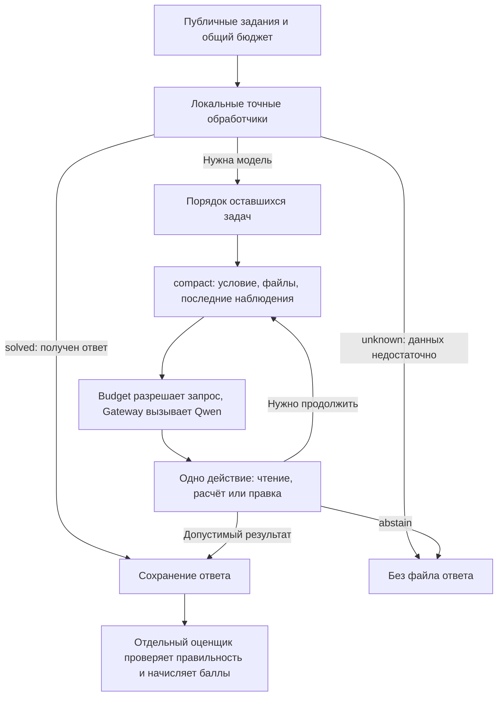

# Что мы решаем и как работает наш агент

**Версия 9 ноября 2026 года, для команды V for Victory.** В корне проекта
находится итоговая **v5**: короткий решатель с несколькими заменами одного файла,
точной математикой, выбором порядка по начальному бюджету и JSON-режимом для
задач кода. Состав и контрольные суммы — в
[решении о поставке](../reports/night_2026-11-09/delivery_selection.json).
Прежние версии и результаты сохранены отдельно. История проверок и границы
независимой оценки подробно разобраны в разделе 10.

Этот текст рассчитан на знание основ машинного обучения и Python. Сначала
разберём задачу, затем проследим конкретные примеры через код и только после
этого обсудим прогноз токенов и результаты.

## 1. В чём конкурсная задача

В официальном прогоне дают 100 заданий: вычислить число, обработать таблицу, найти сведения
в документах или исправить программу. У каждого задания заранее видна награда.
За правильное решение получаем эту награду; пропуск и неверное решение баллов
не добавляют. Все задания делят один бюджет обращений к языковой модели.

Нужно максимизировать сумму наград, уложившись в общий бюджет:

`баллы = сумма наград правильно решённых задач`.

Цена одного обращения к модели считается так:

`стоимость = входные токены / 10 + выходные токены`.

Скидка провайдера за кэш здесь не вычитается: по регламенту весь вход
учитывается полностью.

Вход — всё, что передали модели: инструкции, фрагменты файлов, результаты
предыдущих действий. Выход — сгенерированный ответ модели, в том числе программа
или описание правки. Например, 2000 входных и 300 выходных токенов стоят
`2000 / 10 + 300 = 500` конкурсных единиц. Это единицы бюджета, а не рубли.

Поэтому нам недостаточно просто увеличить долю решённых задач. Одна задача
с наградой 9 может быть ценнее двух с наградами 1 и 5. Но если она съест весь
бюджет и останется нерешённой, выбор окажется неудачным. Нужны одновременно
хороший решатель, разумный порядок задач и аккуратный учёт расхода.

Награды назначаются случайно и не обозначают сложность. При выборе задачи
награда всё равно важна: она задаёт ценность успеха. Просто нельзя рассуждать
«награда больше — значит задача труднее». Подтверждённые ориентиры и пояснения
организаторов собраны в [проверке чата](../reports/night_2026-11-09/contest_chat_refresh.md).

### Чем это отличается от нашей первой идеи

Изначально мы ставили задачу регрессии: по условию и истории работы агента
предсказать, сколько токенов он потратит дальше. Для такого опыта нужны признаки,
целевая величина, разбиение данных и ошибка прогноза.

В соревновании прогноз — возможный инструмент, а конечная цель — баллы.
Даже точный прогноз цены бесполезен, если агент выбирает дешёвые, но неверные
решения. И наоборот, простое правило может быть полезным, если с его помощью
агент решает больше ценных задач при том же бюджете.

Предиктор отвечает: «сколько примерно будет потрачено?». Контроллер принимает
решение: «на что потратить оставшееся?». Языковая модель предлагает решение
задачи. Это три разные части; у нас они не сливаются в одну обученную модель.

## 2. Что приходит на вход и что нужно оставить на выходе

У задания есть папка примерно такого вида:

```text
task_001/
  task.json
  workspace/
    README.md
    prices.py
    test_prices.py
  answer.txt       ← появляется после решения
```

`task.json` описывает задание. `workspace` содержит доступные материалы.
`answer.txt` — результат агента; он расположен рядом с `task.json`, а не внутри
`workspace`. Для задачи без исходников состав рабочей папки будет другим.

[Загрузчик](../submission/task_io.py), функция `load_tasks`, передаёт решателю
только пять публичных полей:

| Поле | Что означает |
|---|---|
| `task_id` | Идентификатор, чтобы связать файлы, вызовы модели и итог |
| `task_type` | Один из типов: `math`, `data_analysis`, `search`, `coding` |
| `instruction` | Условие: что требуется посчитать, найти или исправить |
| `reward` | Награда за правильное решение |
| `check` | Способ проверки, от которого зависит и допустимый формат ответа |

Например, `check="exact_int"` требует целое число одной строкой.
`check="unittest"` используется для ремонта программы: агент оставляет
исправленные исходники и записывает `DONE`.

`check` не содержит правильный ответ. Наличие допустимой строки тоже не
доказывает правильность. `save_answer` проверяет формат и безопасно записывает
файл; отдельный оценщик после работы агента проверяет содержание и начисляет
награду. Для кода открытые тесты видны агенту, а закрытые проверки — нет.

## 3. Весь путь задачи через программу

Начальная точка — [run_agent.py](../run_agent.py), функция `main`.
Она загружает задания, создаёт общий `Budget` и запускает `solve`.
Ожидание `solve` ограничено 3500 секундами через `asyncio.wait_for`;
внешний часовой предел контейнера отдельно задаёт среда соревнования.

Дальше происходит следующее:

1. Задания с нулевой наградой пропускаются; локальные обработчики пробуют
   решить поддерживаемые задачи без модели.
2. Нераспознанные задания попадают в очередь; задачи кода идут туда сразу.
3. Очередь сортируется с учётом наград и того, хватает ли начального бюджета
   на приблизительную суммарную цену оставшихся задач.
4. Для очередного задания `compact.run_task` составляет запрос к модели.
5. `Gateway` вызывает модель через `ReActAgent` и `Runner` openJiuwen.
6. Ответ модели разбирается как одно действие: прочитать, посчитать, исправить,
   записать исходник, сдать ответ или отказаться из-за отсутствия данных.
7. Программа выполняет действие и получает наблюдение: текст файла, вывод Python,
   ошибку или результат тестов. При необходимости это становится входом
   следующего обращения к модели.
8. Когда результат допустим, он сохраняется. Если достигнут предел шагов,
   времени или расходов, агент переходит дальше либо останавливается.

Языковая модель не получает произвольное управление компьютером. Она описывает
одно действие, а наш код решает, как его выполнить и допустимо ли оно.



Стрелка «допустимый результат» означает, что пройдены проверки формата и,
для кода, открытые тесты. Истинную правильность затем устанавливает оценщик.

### Что значит «локальный обработчик»

[workflow.py](../submission/workflow.py) запускает небольшой процесс обработки
через openJiuwen: начало → локальная функция → конец. Здесь нет обращения
к языковой модели. `exact.py` поддерживает несколько точных формулировок
арифметики и поиска; `data_solver.py` — ограниченный язык сумм по CSV.

Это не универсальный понимающий текст решатель. Обработчик должен распознать
всё нужное условие, а не выхватить знакомые слова и угадать остальное.

| Статус обработчика | Что делает `solve` |
|---|---|
| `solved` | Сохраняет найденный ответ |
| `unsupported` | Передаёт задачу модели: поддерживаемая формулировка не распознана |
| `unknown` | Оставляет задачу без ответа: для распознанного вопроса данные отсутствуют, противоречат друг другу или некорректны |

`unknown` здесь не означает неизвестный расход API. Это другой статус,
связанный с содержанием задачи.

### Как устроен порядок задач сейчас

В `run_agent.solve` сначала оценивается цена всей очереди: для каждой задачи
берётся средняя цена её типа и эти цены складываются. Она сравнивается с
доступным бюджетом в конкурсных единицах.

Если бюджета **не меньше** приблизительной суммы, сначала идут все оставшиеся
некодовые задания, затем код. Внутри этих двух групп раньше идёт меньшее значение:

`(размер файлов + 4000) / max(награда, 1)`.

Например, одинаковый объём файлов при большей награде получает преимущество.
Число 4000 — постоянная добавка в эвристике, а не измеренное количество токенов.
Такой порядок сохранён от прежней v3.

Если бюджета меньше приблизительной суммы, раньше идёт **большее** значение:

`награда × вероятность успеха типа / средняя цена типа`.

Числитель — оценка ожидаемых баллов попытки, знаменатель — её ожидаемый расход.
Отношение грубо оценивает баллы на единицу бюджета. Одна общая таблица хранится
в `MEAN_COST` и `SUCCESS_PROBABILITY`:

| Тип | Средняя цена C | Оценка вероятности p |
|---|---:|---:|
| Исправление кода | 1205,9 | 0,780 |
| Анализ таблиц | 497,1 | 0,673 |
| Математика | 392,1 | 0,799 |
| Поиск | 448,5 | 0,689 |

В таблице округление только для чтения. Например, ремонт с наградой 8 получает
примерно `8×0,780/1205,9 = 0,00517`, а математика с наградой 2 —
`2×0,799/392,1 = 0,00408`. При дефиците первым окажется ремонт. Это учебное
сравнение приоритетов, не обещание, что конкретный ремонт будет решён.

Параметры получены из двух запусков старых ста задач: сначала усредняли расход
двух попыток каждой задачи, затем — задач одного типа. Вероятность — доля
успешных попыток типа, слегка приближённая к общей доле 0,735 с весом пяти
дополнительных наблюдений. Это сглаживание уменьшает резкость оценки на малом
числе примеров. Пример из раздела 7 показывает подготовку одной такой строки.

Это **четыре оценки по типам**, а не индивидуальная оценка сложности каждого
задания. Они описывают расход старой политики до её остановки и могут плохо
переноситься на другие задачи и новую политику. Среднее выбрано вместо медианы,
потому что редкие дорогие попытки тоже расходуют общий бюджет: у старого кода
среднее 1205,9 было заметно больше медианы 801,8.

Режим и порядок вычисляются один раз до модельного цикла, после каждого ответа
не меняются. Прогноз цены не разрешает расход — каждый HTTP-запрос всё равно
отдельно проверяют `Gateway` и `Budget`.

Задания обрабатываются последовательно, хотя сам `Gateway` допускает несколько
одновременных запросов. Текущий `solve` эту возможность параллельных вызовов
для нескольких заданий не использует.

## 4. Три учебных примера

Следующие маленькие примеры придуманы для объяснения кода. Это не задания
нового закрытого набора и не измерение качества модели.

### Простая математика без модели

Условие в поддерживаемой формулировке:

```text
A warehouse starts with 100 boxes.
It ships 3 boxes per day for 4 days.
It receives 2 deliveries of 5 boxes each.
How many boxes does it have at the end?
```

`exact._math` распознаёт начальный запас и каждую операцию по порядку:
`100 - 3×4 + 2×5 = 98`. Возвращает `solved` и строку `98`.
`record` вызывает `save_answer`, рядом с `task.json` появляется ответ.
Модель не вызывалась, поэтому модельный бюджет не потрачен.

Если написать принципиально другое математическое условие, это не означает,
что агент умеет так же разобрать его регулярными выражениями. Обработчик
возвращает `unsupported`, и задачу получает модельный цикл.

### Таблица: сначала точная функция, при необходимости модель

Пусть в `sales.csv` находятся строки:

```csv
product,region,month,units,price
A,North,1,2,10
A,North,2,3,5
B,South,1,7,4
```

Поддерживаемое условие:

```text
The file sales.csv has columns product, region, month, units, price.
Compute the total revenue for product 'A'.
```

`data_solver.solve_data` выделяет файл, метрику `revenue` и фильтр `product='A'`.
Затем проверяет столбцы и суммирует `units × price` для подходящих строк:
`2×10 + 3×5 = 35`. Для десятичных значений используется `Decimal`, чтобы
не создавать лишних ошибок двоичного представления дробей. Результат сохраняется
без модели.

Если условие требует неподдерживаемого соединения таблиц или другой операции,
оно идёт модели. Тогда модель может выбрать действие `python`, прочитать CSV,
посчитать результат и вызвать `submit_answer(value)` в своей программе.
Помощник печатает специальную пометку; контроллер извлекает значение, проверяет
успешное завершение программы и формат, затем записывает `answer.txt`.

Важно различать два утверждения: «программа успешно посчитала число» и
«программа правильно поняла условие». Первое видит контроллер, второе проверяет
независимая оценка результата.

### Исправление программы: полный цикл

**Учебный пример.** Он показывает несколько последовательных действий `compact.run_task`: ошибка, чтение, новая правка и сохранение ответа. Пример придуман для объяснения кода.

Пусть в рабочей папке лежат исходник и открытый тест. Условие говорит: `percent` — процент скидки; тест проверяет `discount(100, 10) == 90`. Начальный исходник:

```python
def discount(price, percent):
    return price * (1 - percent)
```

Перед первым обращением `run_task` уже собрал условие, список файлов и начальные фрагменты. Модель могла увидеть нужную строку, но всё равно ошибиться при её переписывании. Она возвращает текст одного JSON-действия; `parse_action` разбирает его, а наш код выполняет указанную операцию. Модель сама файл не меняет.

#### Шаг 1. Правка с неточным фрагментом

Ответ модели:

```json
{"action":"edit","path":"prices.py","before":"return price*(1-percent)","after":"return price*(1-percent/100)"}
```

`editing.apply_edit` проверяет допустимость пути и ищет точное, единственное вхождение `before`. В файле есть пробелы вокруг умножения и вычитания, а в действии их нет. Для этой операции похожего смысла недостаточно: указанный текст отсутствует.

Наблюдение, которое получает цикл:

```json
{"success":false,"changed":false,"path":"prices.py","error":"The before fragment was not found; read the file again"}
```

Ошибка означает: «Фрагмент не найден; перечитайте файл». Исходник остаётся прежним; открытые тесты после отклонённой правки не запускаются. `run_task` записывает действие и наблюдение в историю. Следующий запрос снова содержит условие и сохранённые фрагменты, а также сведения об этой неудаче. Ошибка не обрывает задачу, если ещё разрешён следующий шаг.

#### Шаг 2. Чтение настоящего исходника

Ответ модели:

```json
{"action":"read","path":"prices.py","start":0,"limit":1000}
```

`compact.read_file` читает допустимый файл внутри рабочей папки. Здесь запрошен фрагмент с начала; весь маленький исходник в него помещается. Наблюдение содержит путь, границы фрагмента и текст. Его содержательная часть:

```json
{"path":"prices.py","text":"def discount(price, percent):\n    return price * (1 - percent)\n"}
```

Цикл обновляет `files` — словарь фрагментов, которые сохраняются для следующих обращений. Это память о прочитанном, а не ещё одна копия программы для исполнения. В новом запросе раздел `Current file excerpts` уже содержит настоящий текст с пробелами. В недавней истории остаются неудачная правка и отметка о чтении; текст чтения повторно туда не дублируется. Модель получает конкретное основание для точной замены.

#### Шаг 3. Точная правка и открытая проверка

Ответ модели:

```json
{"action":"edit","path":"prices.py","before":"return price * (1 - percent)","after":"return price * (1 - percent / 100)"}
```

Теперь `apply_edit` находит единственное вхождение. Перед записью `_store_source` проверяет синтаксис через `compile`: это ещё не проверка правильности скидки. После успешной записи `run_task` обновляет сохранённый фрагмент и через `execute_python` запускает `TEST_RUNNER`, который собирает открытые проверки `unittest`.

В придуманном примере тест проходит. Наблюдение в сокращённом виде:

```json
{"success":true,"changed":true,"path":"prices.py","public_tests":{"passed":true}}
```

Полный результат сохраняется в журнале шага. Затем `save_answer(task, "DONE")` записывает `answer.txt` рядом с рабочей папкой. Цикл возвращает `status="completed"` и `saved=true`. Четвёртого обращения за словом `DONE` здесь нет: его сохраняет сама программа после успешного теста. Следующий запрос по этой задаче уже не строится.

#### Где потрачены токены

Все три JSON-действия в этой истории были ответами модели. Даже первое, бесполезное действие уже потратило входные и выходные токены. Само локальное чтение, поиск замены, проверка синтаксиса и запуск тестов к API не обращаются. Однако текст файла и наблюдения, включённые в следующий запрос, становятся его входными токенами. Поэтому локальная ошибка может увеличить дальнейший расход.

## 5. Главные файлы: что в них искать

| Файл | Главные функции и роль |
|---|---|
| [run_agent.py](../run_agent.py) | `main`, `solve`, `record`: запускает работу, выбирает порядок и сохраняет журнал задач |
| [task_io.py](../submission/task_io.py) | `load_tasks`, `save_answer`, `atomic_write`: публичные поля и допустимая запись ответа |
| [workflow.py](../submission/workflow.py) | `run_local`: выполняет локальный обработчик через openJiuwen |
| [exact.py](../submission/exact.py) | `solve_exact`: точные поддерживаемые формулировки математики и поиска |
| [data_solver.py](../submission/data_solver.py) | `solve_data`: полностью разбирает поддерживаемую сумму и фильтры CSV |
| [compact.py](../submission/compact.py) | `run_task`, `read_file`, `parse_action`: запрос, одно действие, наблюдение, следующий шаг или ответ |
| [editing.py](../submission/editing.py) | `apply_edit`, `write_source`: ограниченные изменения Python-файлов |
| [code_solver.py](../submission/code_solver.py) | `TEST_RUNNER`, `_passing`: запуск и разбор результатов открытых тестов |
| [gateway.py](../submission/gateway.py) | `Gateway.answer`, `_request`, `_response`: вызов модели и учёт отправленного HTTP-запроса |
| [budget.py](../submission/budget.py) | `Budget.reserve`, `settle`, `remaining_units`: разрешение расходов и остаток |
| [executor.py](../submission/executor.py) | `execute_python`: исполнение программы с ограничениями |
| [schedule.py](../submission/schedule.py) | Прежние структуры оценок для опытов с планировщиком; текущий `solve` их не вызывает |

Не все существующие функции входят в этот путь. Например, локальный поиск
правок `code_solver.solve_code` есть в файле, но основной `solve` направляет
код сразу модели. Старые `task_io.make_prompt` и `apply_code_answer` тоже
не являются текущим циклом `compact.run_task`. Наличие функции в проекте
не означает, что она участвует в приведённом сравнении.

### Что хранит `compact.run_task`

На начало задачи он строит список файлов и читает фрагменты общим объёмом
до 18 000 символов. Затем в каждом запросе передаются условие, список файлов,
сохранённые фрагменты и два последних действия с результатами. Всю историю
с начала задачи код заново не отправляет.

В текущей v5 для каждого файла хранится один согласованный
фрагмент. Перекрывающиеся или соседние чтения объединяются, если совпадает
общая часть и результат не длиннее 20 000 символов. Раздельные фрагменты не
склеиваются через непрочитанный промежуток. Общий объём памяти — 24 000
символов; при переполнении удаляется давно не обновлявшийся файл. После правки
старый фрагмент исходника удаляется и читается новое начало: модель не должна
исправлять уже устаревший текст.

README.md с требованиями дополнительно передаётся для каждой задачи кода,
независимо от этой памяти. Предел — 20 000 символов. Если документ длиннее,
модель видит явную пометку о неполном чтении и может запросить продолжение.
Это помогает удержать требования, но не гарантирует, что модель их выполнит.

По умолчанию разрешено до восьми действий. Верхний предел ответа модели
на одно действие — 1536 токенов; при малом остатке бюджета он уменьшается.
Если места для минимального ответа не хватает, следующий запрос не отправляется.
Неверный JSON или неудачная операция возвращают наблюдение об ошибке, после
чего следующая попытка всё равно занимает очередной шаг и может тратить токены.

### Зачем несколько замен в одном действии

Открытые тесты неполны. Раньше агент мог исправить один метод, увидеть успешный
тест и сразу сохранить DONE, хотя условие требовало изменить ещё и связанный
метод. Новая операция позволяет перечислить до восьми замен **в одном файле**:

Возьмём отдельный учебный файл `offers.py`. Его условие требует считать скидку
в процентах и разрешать значение, равное пределу:

```python
def discounted(price, percent):
    return price * (1 - percent)

def allowed(value, limit):
    return value < limit
```

Тогда обе правки можно передать вместе:

```json
{"action":"edit","path":"offers.py","changes":[
  {"before":"    return price * (1 - percent)\n","after":"    return price * (1 - percent / 100)\n"},
  {"before":"    return value < limit\n","after":"    return value <= limit\n"}
]}
```

`editing.apply_edit` последовательно применяет замены
в памяти, проверяет уникальность каждого фрагмента и синтаксис итогового Python.
Только после этого записывает файл один раз. Затем `compact.run_task` запускает
открытые тесты.
Если вторая замена недопустима, первая тоже не записывается. Это не транзакция
на несколько файлов и не автоматическое обнаружение всех ошибок: набор замен
по-прежнему предлагает модель. После успешной открытой проверки агент может
завершить задачу; скрытые проверки ему недоступны.

### Где именно openJiuwen

`Gateway.answer` создаёт настоящий `ReActAgent`, настраивает модель и вызывает
его через `Runner`. Внутренний агент ограничен одной итерацией. Несколькими
действиями управляет внешний цикл `compact`, который мы только что разобрали.

Поэтому одна итерация `ReActAgent` не означает, что задача решается одним
обращением. На следующем шаге внешний цикл снова вызывает модель, передав
наблюдение от предыдущего действия.

### Что добавляет SymPy

Для математических задач инструкция разрешает уже установленный SymPy 1.14
вместе со стандартной библиотекой: точные дроби `Rational`, решение уравнений,
работу с многочленами и задачами линейной оптимизации. Модель составляет
математическую постановку и программу, обычная библиотека считает результат.
Это не дополнительная нейросеть и не дообучение Qwen.

Для линейной оптимизации предложен `sympy.solvers.simplex.lpmax` с явно
заданными ограничениями. В нашей установленной версии проверка `linprog`
на свободных и отрицательных переменных дала неверные результаты даже без
ограничителя Python; соответствующий путь не рекомендуется. Описание и
воспроизведения сохранены в [диагностике](../reports/night_2026-11-09/sampling_and_lp_verification.md).
Это обнаруженные случаи данной версии, а не утверждение обо всех версиях SymPy.

Пакеты SymPy и mpmath устанавливаются при сборке по закреплённым хешам.
Два обращения SymPy к `ctypes.sizeof` заменены эквивалентным вычислением размера
через `struct`, чтобы импорт работал в ограниченном исполнителе. Правила доступа
исполнителя ради библиотеки не ослаблялись. Ошибочная система уравнений всё
равно даст ошибочный ответ: библиотека не сверяет постановку с текстом задачи.
Остальные типы задач получают прежнюю инструкцию о стандартной библиотеке;
условия конкретного задания также должны соблюдаться.

### Как программа модели исполняется в Docker

В поставке агент уже запущен в контейнере. `executor.execute_python` создаёт
внутри него отдельный Python-процесс с ограничениями времени, памяти, вывода
и файлового доступа. Среда этого процесса не содержит ключа API. Обычные
операции сети, запуска других процессов и изменения тестов запрещены.
После исполнения контроллер также сверяет хеши исходных данных и тестов.

В Linux родительский процесс заранее запрещает обычный доступ дочернего
процесса к его памяти и окружению и проверяет, что запрет установлен. Внутри
дочернего Python запрещены также изменения прав файлов и обычные способы
доступа к памяти через ctypes/cffi. Эти меры закрывают конкретные найденные
обходы; они не превращают проверку Python в полноценную изоляцию операционной
системы. Запускать полученный от модели код вне контейнера по-прежнему нельзя.

Исполняемый текст получает настоящий модуль `__main__` и чистый список
аргументов. Поэтому `unittest.main()` больше не принимает технический аргумент
исполнителя за имя теста. Текст ошибки содержит строку сработавшего `assert`.
Успех открытых тестов требует ненулевого числа тестов **и** кода завершения 0;
надпись об успехе перед последующим падением программы не считается успехом.

В локальных сравнениях это организовано иначе на внешнем уровне:
[runtime.py](../experiments/agent_night_2026-11-09/runtime.py) поднимает отдельный
Docker без сети для каждого исполнения Python и передаёт ему исполнитель
из зафиксированной версии. Оценщик запускает свои проверки отдельно.
Так модельный код не выполняется непосредственно в пользовательском Python
на Mac. Сам Python-контроль доступа дополняет контейнер, но не заменяет его.

## 6. Бюджет: расход, резерв и прогноз

Для конкурса цена обращения равна **`O + I/10`**, где `I` — входные токены, а `O` — весь тарифицируемый выход. Это единицы конкурсного бюджета, не рубли.

Внутри [Budget](../submission/budget.py) считаем целыми числами: **`I + 10×O`**. Одна внутренняя единица соответствует 0,1 конкурсной. Поэтому бюджет 1000 хранится как `limit_units=10000`. Известный расход — `spent_units`, удержанные резервы — `reserved_units`.

### Как узнаём фактический расход

Ответ API содержит `usage`: поля `prompt_tokens`, `completion_tokens`, `total_tokens`. `Budget.settle` проверяет их согласованность и заменяет резерв измеренной ценой. Если есть общий итог, выход вычисляется как `total_tokens - prompt_tokens`; иначе используется допустимый `completion_tokens`. Уже включённые токены рассуждений второй раз не прибавляются.

Это измерение по сведениям сервиса после обращения. До отправки их ещё нет.

### Что резервируем перед отправкой

[Gateway._request](../submission/gateway.py) получает **реальное сериализованное тело HTTP-запроса**, а не только текст условия. Для допуска запроса используются:

```text
input_bound = число байтов тела запроса + 256
резерв во внутренних единицах = input_bound + 10 × max_output
```

`max_output` здесь — предел выхода из отправляемого запроса, поле `max_tokens`. `Budget.reserve` разрешает отправку только при наличии места под этот резерв с учётом уже известных расходов и других резервов. Предварительная проверка `afford` сама такого разрешения не даёт.

Байтовая граница — **допущение нашего допуска**, а не документированная верхняя гарантия сервера. Служебные добавки сервиса могут не содержаться в теле запроса. После получения достоверного `usage` отдельно проверяются `I <= input_bound` и `O <= max_output`. Нарушение запрещает дальнейшие выделения с причиной `request_bound_exceeded`, но не отменяет уже случившийся расход. Фактическая цена при этом записывается полностью.

Обученный прогноз отвечает на другой вопрос: сколько агент, вероятно, потратит. Он может помогать выбирать задачи, но ожидаемая цена не заменяет резерв и не разрешает отправку.

### Условный пример

**Следующие числа придуманы для объяснения.** Общий бюджет — 1000. Пусть тело запроса занимает 1744 байта: `input_bound=2000`, предел выхода — 500 токенов. Резерв равен `(2000 + 10×500)/10 = 700` конкурсных единиц.

Сервис затем сообщает `I=1200`, `O=200`. Фактическая цена — `1200/10 + 200 = 320`. Резерв закрывается; остаётся **680**, а не 300.

Следующему запросу выделили резерв 500, но достоверный расход не получили:

| Состояние | Известно потрачено | Удерживается | Арифметический остаток | Доступно для новых запросов |
|---|---:|---:|---:|---:|
| Первый запрос отправлен | 0 | 700 | 300 | 300 |
| Его расход получен | 320 | 0 | 680 | 680 |
| Расход второго неизвестен | 320 | 500 | 180 | **0** |

Последняя строка переводит бюджет в `frozen` с причиной `unknown_usage`: `remaining_units` возвращает ноль. Неизвестный запрос не считается бесплатным. Его резерв не освобождается через `release`: эта функция предназначена только для ещё не отправленного запроса.

**Реальный отдельный эпизод ночи:** после HTTP 429 было известно потрачено **3207,3**, а **3475,6** осталось удержанным резервом — см. [сохранённый итог запуска](../experiments/agent_night_2026-11-09/batch_edit27_hard25/runs/r1/summary.json). Последнее число — не установленная цена ошибки. Без достоверного `usage` агент остановил новые обращения и автоматически не повторял неизвестный запрос. Конкретную причину HTTP 429 по имеющимся сведениям не установили. Это наблюдение работы защиты, а не завершённое сравнение качества агента.

### Порог задачи и время

Перед очередным обращением проверяется порог задачи:

`max(15000, B_internal // 4)`.

При общем бюджете 20 000 конкурсных единиц `B_internal=200000`; порог — 50 000 внутренних, то есть **5000 конкурсных единиц**. Проверка происходит **между обращениями**. Последний разрешённый ответ может перевести расход через этот порог; общий резерв перед отправкой всё равно проверяется. Это не жёсткий потолок цены каждого ответа.

Ожидание данных ответа ограничено 180 секундами, установление соединения — 10 секундами. Эти ограничения отдельных этапов обмена не равны общей длительности запроса. Отдельно вся работа агента ограничена 3500 секундами.

## 7. Где находятся данные и обученные прогнозы

Здесь четыре связанных, но разных опыта. Сначала нужно определить, что означает
одна строка данных и какую величину предсказываем.

| Опыт | Данные | Цель |
|---|---|---|
| Netpreme: весь запуск | Чужие записанные траектории кодовых агентов и публичные описания задач | Суммарные выходные токены записанного запуска |
| Ночная оценка начальной цены | Наши старые 100 инженерных задач, два запуска json_cues27 | Расход до остановки: O + I/10, усреднённый по двум запускам задачи |
| История после 1/2/4/8 вызовов | Завершённая часть траектории Netpreme | Ещё не потраченные выходные токены |
| Испытания агента | Замороженные задания и отдельная проверка правильности | Баллы за верные решения и фактический расход общего бюджета |

В Netpreme `osl` — выходные токены обращения, `isl` — полный вход,
`isl_new` — новый вход. Пропуск счётчика остаётся неизвестным, а не нулём.
Это другой источник, не сто наших ночных задач.

### Одна настоящая строка: от файлов до 19 признаков

Возьмём старую задачу `stress_ranges_0`: исправить объединение пересекающихся
и соседних целочисленных интервалов, сохранить входной список и обработать
оговорённые неверные аргументы. До решения доступны README.md — 329 байт,
subject.py — 554, test_public.py — 354: всего **1237 байт и три файла**.
Отдельная инструкция содержит **92 символа**.

Символы, байты и токены — разные единицы. Например, «я» — один символ и два
байта UTF-8; число токенов зависит от разбиения текста конкретной моделью.
Входные токены считаются для всего контекста модели, включая служебную
инструкцию и переданные файлы. Из 92 символов или 1237 байт нельзя напрямую
получить число входных токенов.

[Извлекатель признаков](../reports/night_2026-11-09/initial_cost_prediction.py)
читает исходные публичные файлы. Python разбирается в синтаксическое дерево
без исполнения: его узлы описывают операции, имена, условия и другие части кода.

| Признак | Значение | Что именно считается |
|---|---:|---|
| type_coding | 1 | Задача на исправление кода |
| type_data_analysis | 0 | Индикатор анализа таблиц |
| type_math | 0 | Индикатор математики |
| type_search | 0 | Индикатор поиска |
| instruction_chars | 92 | Символы полной инструкции |
| total_bytes | 1237 | Байты исходных файлов workspace |
| file_count | 3 | Число этих файлов |
| py_files | 2 | Файлы .py, включая публичный тест |
| table_files | 0 | Файлы CSV и TSV |
| text_files | 1 | Документы .md и .txt |
| json_files | 0 | Файлы .json |
| other_files | 0 | Файлы остальных расширений |
| source_lines | 26 | Строки обоих Python-файлов |
| ast_nodes | 248 | Узлы их синтаксических деревьев |
| functions | 2 | Явные объявления def и async def |
| branches | 3 | if, условные выражения и match |
| loops | 3 | for, while и циклы в выражениях вроде [x for x in xs] |
| imports | 2 | Инструкции import и from…import |
| test_functions | 0 | Объявления функций с именем test… |

Четыре первых числа кодируют одну категорию. Остальные 15 описывают размеры
и форму файлов. Ноль test_functions здесь не означает отсутствие тестов:
методы создаются через setattr, а не объявляются как def test….
Счётчики не измеряют сложность задачи непосредственно.

Бустинг получает все **19 чисел**: последние 15 преобразуются в ln(1+x),
индикаторы остаются 0/1. Например, 1237 → 7,1213. Логарифм сжимает
разброс размеров. Ridge получает **семь чисел**: четыре
индикатора и логарифмы instruction_chars, total_bytes, file_count.
Ridge — линейная регрессия со штрафом на большие коэффициенты.
Параметры стандартизации вычисляются только по обучающим данным.
Награда, task_id, ответы, правильность решения и будущие действия
в признаки цены не входят. Полный вектор и проверка его совпадения сохранены
в [разобранной строке](../reports/night_2026-11-09/training_example_for_guide.json).

### Как из реальных токенов получается цель 193,7

Для каждого обращения берём полный вход I и выход O из usage.
Конкурсная цена — I/10 + O. Складываем все обращения до остановки:

| Запуск этой задачи | Измеренные обращения | Суммарная цена |
|---|---|---:|
| r1 | 829/10 + 61 | 143,9 |
| r2 | (829/10 + 24) + (876/10 + 49) | 243,5 |

Одна строка обучения получает **y = (143,9 + 243,5)/2 = 193,7**.
Два повтора — одна задача с равным весом, а не две независимые задачи.

Это цена **наблюдённой остановки данной политики**. Политика включает модель,
подсказки, инструменты и правила завершения. Дешёвая остановка может быть
неверным решением; цель не равна минимальной цене правильного ответа.
Изменение политики меняет распределение расхода. Здесь обучаем небольшой
предиктор по записанным запускам, не дообучаем Qwen.

### Как обучаем и проверяем модели

В опыте 100 строк задач и 76 групп родственных задач. Все четыре варианта
stress_ranges_0, _1, _2, _3 входят в одну группу. В проверочной части №0
сразу все четыре отложены: **75 задач для обучения, 25 для проверки**;
ни одного варианта этой группы среди обучающих нет.

Проверка состоит из пяти частей по группам. В каждом разбиении модель обучается
на остальных группах. Стандартизация Ridge, медианы, коэффициенты и деревья
получаются только из обучающей части; каждая строка получает прогноз модели,
не видевшей её группу. Повторы одной задачи уже усреднены. Так близкий вариант
не подсказывает ответ проверяемому варианту.

| Вариант | Что подбирается только на обучающей части | Прогноз для y=193,7 | Абсолютная ошибка |
|---|---|---:|---:|
| Медиана по типу | Медиана цен обучающих coding-задач | 847,0 | 653,3 |
| Ridge | Масштабы семи признаков, коэффициенты и свободный член при фиксированном штрафе 10 | 941,4 | 747,7 |
| Бустинг | До 100 последовательно уточняющих прогноз деревьев, до семи листьев в дереве | 767,2 | 573,5 |

Ridge и бустинг обучаются на ln(1+y). Возврат к цене использует экспоненту
и поправку по ошибкам **обучающей части**. Медиана считается прямо по ценам.
Все три прогноза этой задачи завышены.

На всех **100 проверочных прогнозах** средняя абсолютная ошибка:
медиана — **395,4**, Ridge — **402,7**, бустинг — **405,6** единицы цены
на задачу. Это средняя величина промаха, не доля правильных решений.
На одном примере бустинг ближе, а по всему набору медиана точнее.
Другая проверка — насколько верно модель упорядочивает цены.
[Полный отчёт](../reports/night_2026-11-09/initial_cost_prediction.json)
содержит разбиения и все прогнозы.

### Отдельная цель: сколько осталось после нескольких вызовов

**Следующий пример вымышленный и относится к выходным токенам, а не к цене 193,7.**
Пусть записанные выходы четырёх обращений: **100, 200, 50, 150**.
После второго доступны два завершённых вызова, потрачено 300, последний
выход 200, средний 150. Обучающая цель — **остаток 200 = 50 + 150**.

Будущие 50 и 150, а также число будущих вызовов в признаки не передаются.
Они известны только при подготовке обучающей записи. Аналогично строятся
точки после 1, 2, 4 и 8 вызовов; для уже законченной траектории активная точка
не создаётся. [Подготовка истории](../src/token_prediction/prepare_online.py)
использует только завершённую часть. Здесь прогнозируется остаток O;
для будущей конкурсной цены дополнительно потребовался бы будущий I/10.

### Что подключено к агенту

Исследовательский [ForecastModel](../src/token_prediction/forecast.py)
не подключён к run_agent: веса этих моделей не управляют его вызовами.
Выбранная очередь использует простую таблицу средних цен и вероятностей
по нашим старым запускам из раздела 3, не трансформер Netpreme.
Её пользу оцениваем по баллам при общем бюджете; разрешение каждого
запроса по-прежнему даёт Budget.

### Чего не хватает для решения «продолжать ли эту задачу»

Остаток токенов и польза следующего шага — разные цели. Короткое продолжение
может снова закончиться ошибкой; длинное — принести награду. Поэтому одного
столбца с токенами недостаточно для хорошего распределения бюджета.

Для следующего опыта полезно после каждого действия сохранять промежуточный
код и проверять его отдельным исследовательским оценщиком. Тогда можно
различить три ситуации: результат уже верен, но ещё не сдан; очередной шаг
впервые исправляет задачу; дальнейшие шаги не помогают. Вместе с оставшейся
ценой это даёт материал для оценки полезности продолжения.

Закрытая правильность используется только как обучающая метка и оценка,
не как признак или доступный агенту инструмент. Попытка, прерванная лимитом,
не сообщает, сколько стоило бы гарантированное правильное решение: эту
неизвестность нельзя заменить её наблюдённым расходом. Пока такой подход
не показал дополнительных баллов на новых задачах, он остаётся следующим
исследованием, а не частью поставки.

## 8. Как понимать результат сравнения

У одной строки отчёта есть несколько разных показателей:

| Показатель | На какой вопрос отвечает |
|---|---|
| Правильно решённых / выполнимых | Сколько задач прошли независимую проверку |
| Баллы / достижимая награда | Сколько награды получили с учётом разных весов задач |
| Фактическая стоимость | Сколько измеренно потратили все известные обращения |
| Неизвестные обращения и резерв | Есть ли расходы, которые нельзя назвать точным нулём или точной суммой |
| Отказы при недостатке данных | Не выдумывал ли агент ответ там, где его нельзя вывести |

`saved=true` означает, что ответ удалось сохранить в допустимом формате. В показанной ветви исправления программы `completed` также означает успешную открытую проверку и запись `DONE`. Эти признаки не подтверждают прохождение скрытых тестов. Поле `reward` в `agent-report.json` — заранее известная возможная награда за задачу; оно присутствует и у неудачной попытки, поэтому суммировать его как заработанные баллы нельзя. Правильность проверяет отдельный оценщик. Фактически начисленные в локальном сравнении баллы нужно смотреть в `score.json`, а официальный результат — в оценке организаторов.

Например, `391/433` — сумма наград относительно достижимой награды конкретного
набора, а `73/80` — число правильно решённых задач. Эти дроби не взаимозаменяемы.
Если в наборе есть задания с доказанно недостающими данными, они отдельно
учитываются как недоопределённые. Правильный отказ не добавляет награду,
поэтому такие задания не увеличивают достижимый знаменатель.

Поле оценщика `unsolvable_abstained` буквально означает, что у недоопределённой
задачи нет сохранённого ответа. Причина может быть сознательным `abstain`,
нехваткой бюджета или отсутствием попытки. Чтобы различить их, нужны
`task_results.json` и квитанции. И обратное: объяснение «данных недостаточно»,
записанное моделью как `answer` вместо `abstain`, станет файлом ответа, хотя
человек прочтёт его как отказ. Проверяем смысл и протокол отдельно.

### Откуда взялись наши задания

Организаторы выдали восемь примеров в task-dir.zip. Остальные перечисленные
ниже наборы мы подготовили для собственных проверок. Они не являются скрытыми
заданиями финала соревнования.

| Набор | Происхождение и назначение | Выполнимых задач | Достижимые баллы |
|---|---|---:|---:|
| 100 инженерных | Уже изученные задачи и варианты известных семейств; поиск ошибок и отбор первых идей | 80 | 433 |
| 32 проверочных | Новые сюжеты, в том числе полные модули из восьми других открытых проектов; выбор между вариантами | 26 | 138 |
| 64 отложенных | Ещё 24 открытых проекта и новые не-кодовые задачи; большая часть дефектов кода внесена искусственно; проверка после выбора | 52 | 256 |
| 16 резервных | Четыре настоящих исторических исправления в новых проектах и 12 других задач; отдельная проверка переноса | 13 | 64 |

В каждом наборе есть задачи с доказанно недостающими сведениями. Признак
выполнимости и правильные ответы находятся у оценщика; агент их не получает.
Награды назначались независимо от сложности. Достижимые баллы в таблице
исключают награды заданий, ответ на которые нельзя однозначно вывести.

Сто инженерных заданий — это не сто независимых сюжетов: часть из них является
вариантами одной задачи. Для исследования цены они объединены в 76 групп.
Два запуска одного набора дают два измерения поведения модели, а не два новых
набора. После разбора результатов 32 и изменения алгоритма по ним этот набор
становится разработочным. Итоговый код нужно зафиксировать до просмотра
результатов следующего отложенного набора.

У эталонов тоже возможны ошибки. Поэтому проверялись правильный вариант,
пустой ответ и исходный дефектный код; для программ добавлены намеренно
неполные исправления, которые проходят публичные тесты, но должны провалить
закрытые. Другой проверяющий отдельно получал ответы из публичных условий
до знакомства с эталоном. Это внутренние проверки нашего исследовательского
процесса, а не официальная аттестация организаторов.

Искусственные ответы HTTP-сервера проверяют совместимость и арифметику учёта.
Они не проверяют способность настоящей Qwen решить задачу. И наоборот,
хороший балл одного запуска не доказывает, что архив поставки действительно
запускается: для него нужна отдельная проверка контейнера и входной команды.

## 9. Как воспроизвести сравнение

Команды сравнения ниже относятся к полному исследовательскому проекту с
наборами и снимками опытов. Комплект для сдачи содержит работающий агент;
его самостоятельная сборка и запуск показаны в конце этого раздела.

Главный сценарий ночных опытов:
[compare.py](../experiments/agent_night_2026-11-09/compare.py).
У него три отдельных действия:

| Действие | Что фиксируется или выполняется |
|---|---|
| `prepare` | Копии исходников, публичных заданий, программы запуска; модель, бюджет, порядок, образ и контрольные суммы оценщика |
| `run` | Свежая копия рабочих папок и реальная работа модели; результаты и каждое обращение сохраняются отдельно |
| `score` | Независимая проверка оставленных ответов и исходников в Docker |

После фиксации опыт исполняется из собственной копии кода. Изменение корневого
`compact.py` не должно незаметно менять уже записанный эксперимент. Существующие
имена запусков и результаты не перезаписываются.

Для просмотра готового отчёта модель вызывать не нужно:

```sh
cd /Users/vik0t/hacks/open-jiuwen-agent-token-prediction
.venv/bin/python -m json.tool reports/night_2026-11-09/final_results.json
```

Пример нового повтора уже зафиксированных v4 и итоговой v5 на наборе 16.
После наших запусков он, конечно, уже знаком команде; это воспроизведение,
а не новая независимая проверка. Здесь нужен файл доступа к тому провайдеру,
который записан в фиксации;
вместо `/path/to/private.env` подставляется его локальный путь.

```sh
jiuwen_python=.cache/jiuwenswarm-venv/bin/python
$jiuwen_python experiments/agent_night_2026-11-09/compare.py run --name confirm16_v4_b16000 --run team_repeat_01 --credentials /path/to/private.env
$jiuwen_python experiments/agent_night_2026-11-09/compare.py score --name confirm16_v4_b16000 --run team_repeat_01
$jiuwen_python experiments/agent_night_2026-11-09/compare.py run --name format16_v5_b16000 --run team_repeat_01 --credentials /path/to/private.env
$jiuwen_python experiments/agent_night_2026-11-09/compare.py score --name format16_v5_b16000 --run team_repeat_01
```

`run` заново расходует выданную квоту модели. Просмотр JSON и сборка сводки
не вызывают модель. Среда `.cache/jiuwenswarm-venv` содержит совместимую версию
openJiuwen; обычный `.venv` используется в других частях исследования.

[summarize.py](../reports/night_2026-11-09/summarize.py) сверяет фиксацию,
уникальные отправленные запросы, сумму фактического расхода и итог по каждому
заданию. Сводку двух новых повторов можно собрать так:

```sh
.venv/bin/python reports/night_2026-11-09/summarize.py --run confirm16_v4_b16000:team_repeat_01 --run format16_v5_b16000:team_repeat_01 --output reports/night_2026-11-09/team_repeat_01.json
```

В каталоге запуска стоит сначала читать `summary.json` и `score.json`, а затем
для конкретной ошибки — `calls.jsonl` и `task_results.json`. `summary` объясняет
стоимость и остановку, `score` — качество. Считать отдельные строки шагов
как отдельные решённые задачи нельзя.

### Собрать и запустить поставку

Ниже нужны Docker и отдельная **рабочая копия** заданий: агент изменяет
исходники и добавляет ответы. `submission/requirements.lock` закрепляет SDK,
`math_requirements.lock` — математические пакеты. Они устанавливаются только
при сборке; во время решения загрузок пакетов нет.

```sh
docker build -t jiuwen-contest .
export CONTEST_TASKS_DIR=/absolute/path/to/a-working-copy
docker run --rm --read-only --network none --cap-drop ALL \
  --security-opt no-new-privileges --cpus=4 --memory=16g --pids-limit=128 \
  --tmpfs /tmp:rw,size=2g,mode=1777 \
  -v "$CONTEST_TASKS_DIR:/tasks:rw" -e TASKS=/tasks -e BUDGET=0 \
  jiuwen-contest --no-llm
```

Это путь **без модели**; ремонт кода моделью в нём не выполняется.
Для полноценного решения внешний закрытый env-файл должен задавать
`LLM_BASE_URL`, `LLM_API_KEY`, `BUDGET`; при необходимости — `LLM_MODEL`.
Сами значения ключа в код и архив не записываются. Контейнеру нужен маршрут
к выбранному API:

```sh
export CONTEST_ENV_FILE=/absolute/path/to/private.env
docker run --rm --read-only --cap-drop ALL \
  --security-opt no-new-privileges --cpus=4 --memory=16g --pids-limit=128 \
  --tmpfs /tmp:rw,size=2g,mode=1777 --env-file "$CONTEST_ENV_FILE" \
  -v "$CONTEST_TASKS_DIR:/tasks:rw" -e TASKS=/tasks \
  jiuwen-contest
```

Без `BUDGET` входная программа использует ноль. Локальная таблица цен его
не придумывает. Вывод `agent-report.json` содержит измеренный расход и ход
задач, но начисленные правильные баллы определяет отдельный оценщик.

## 10. Что показали ночные сравнения

Все баллы ниже получены нашим отдельным оценщиком на собственных задачах.
Обращения к настоящей Qwen шли через выданный организаторами API. Это не
официальная таблица соревнования и не результат скрытых финальных заданий.

### Поиск варианта на 32 задачах

В наборе 26 выполнимых задач с общей достижимой наградой 138 и шесть задач
с недостающими данными. Для каждого основного варианта выполнены два повтора
при бюджете 32 000 и два при 16 000. Показано **среднее наград**, а не число
верных задач. Например, 114,75 получается как `(123+128+101+107)/4`.

Эти уровни соответствуют 1000 и 500 единицам на задачу в среднем. Для 64 задач
бюджеты пропорционально увеличены до 64 000/32 000, для 16 — 16 000/8000.
Но отдельные квоты по 1000 не выдаются: все задания расходуют одну общую сумму.
Два уровня проверяют свободный и дефицитный режимы. Их равный вес назначен
для выбора заранее; это не опубликованное распределение бюджетов финала.

| Вариант | Средние баллы при 32 000 | При 16 000 | Среднее четырёх запусков |
|---|---:|---:|---:|
| Прежняя v3 | 98 | 80 | 89 |
| Общие исправления памяти, исполнения и учёта | 104 | 91 | 97,5 |
| То же и постоянное предъявление README | 111,5 | 96 | 103,75 |
| README и несколько замен одного файла | 123,5 | 86 | 104,75 |
| Один отложенный повторный просмотр кода | 121,5 | 92 | 106,75 |
| Два прохода кода по четыре действия | 108 | 95 | 101,5 |
| Очередь по средней цене и вероятности типа | 116 | 95 | 105,5 |
| Обычный агент с историей ReActAgent | 37 | 28 | 32,5 |
| Общие исправления, контроль в образе с SymPy | 108 | 95 | 101,5 |
| То же и математическая инструкция SymPy | 115,5 | 96,5 | 106 |
| README, замены и два прохода по два и шесть действий | 122,5 | 89,5 | 106 |
| **v4, выбранная перед проверкой 64: README, замены, SymPy, очередь** | **125,5** | **104** | **114,75** |

Первая серия — восемь вариантов; затем по её диагностике добавлены три
основных варианта и одна композиция. Проверенные квитанции и значения:
[первые 32 запуска](../reports/night_2026-11-09/val32_core_complete_checked.json),
[12 дополнительных](../reports/night_2026-11-09/val32_supplement_checked.json),
[последние шесть](../reports/night_2026-11-09/val32_final6_checked.json).
Все 50 завершённых запусков имеют согласованный измеренный расход,
нулевой удержанный резерв и расход в пределах своего бюджета.
Это 50 запусков **одних 32 задач**, а не 1600 независимых задач.

В последних шести также были два одноразовых опыта формата: принудительный
JSON для кода дал 128 при 32 000, восстановление одного объекта после короткого
вступления — 120. Для них нет четырёх сопоставимых повторов, поэтому их
одиночные баллы не использовались вместо среднего основных вариантов.
Они не вошли в выбранный код.

Среда первых восьми вариантов была прежней; математические опыты выполнены
с установленным SymPy и отдельным контролем в том же образе. Поэтому
окончательная проверка всех трёх агентов использует **один общий образ**.
Разницу случайных повторов нельзя объяснять сменой образа без отдельного опыта.

В реально отправленных запросах проверено `temperature=0`; `seed` и `top_p`
не задаются. Даже так сервис не дал побитовой повторяемости. Разный первый
ответ меняет дальнейшую историю и распределение бюджета. Поэтому приводим
все назначенные повторы и не называем разницу двух близких средних доказанной
пользой конкретной строки инструкции.

### Что удалось понять по ошибкам

У короткого решателя с общими исправлениями в одном полном запуске пять
ремонтов не завершились из-за бюджета; четыре из них вообще не получили
модельного запроса. Дорогая математическая попытка стоила 7082,4 единицы.
Больше шагов на одну сложную задачу может означать меньше решённых остальных.

В другом случае исправление конструктора словаря не исправило обновление
значений, а изменение вспомогательной функции URL не изменило вызывающий код.
Открытая проверка прошла, закрытая — нет. Это конкретные случаи неполного
выполнения требований; они объясняют, зачем показывать README и разрешать
совместные замены, но не доказывают универсальную пользу каждого механизма.

Повторный просмотр не дал основания усложнять поставку: при 32 000 оплатили
по одному просмотру в каждом повторе, оба не дали принятой правки; при 16 000
не оплатили ни одного. Более высокий средний балл этой строки нельзя приписать
полезной перепроверке. Подробная [диагностика всех 32 запусков](../reports/night_2026-11-09/validation32_diagnosis.md)
сохраняет типы ошибок и стоимость.

На старых ста задачах также отклонены обязательный план с собственными тестами,
массовые перепроверки и простое увеличение числа действий. Первый удачный
опыт принудительного JSON дал 408, следующий — 374; по двум повторам среднее
391 не превысило 392 у контроля. Выбирать только первое число было бы ошибкой.
[Старые инженерные сравнения](../reports/night_2026-11-09/results.md) сохранены
вместе с отрицательными результатами.

### Заключительная проверка на новых задачах

Код v4 зафиксирован до запуска отложенных 64 и 16 задач. На 64 сравниваются
v3, v4 и настоящий обычный агент на одной модели и в одном образе при бюджетах
64 000 и 32 000, по два повтора. На отдельных 16 задачах с четырьмя историческими исправлениями
и 12 другими сюжетами — пара v3/v4 при 16 000 и 8000, также по два повтора. Условия выбора
заранее записаны в [протоколе](../reports/night_2026-11-09/confirmation_protocol.md).

На 64 завершены все 12 назначенных запусков. Ниже средние двух повторов;
максимум 256 баллов и 52 выполнимые задачи. Стоимость — фактические конкурсные
единицы, а бюджет — общий разрешённый предел на весь запуск.

| Бюджет | Агент | Баллы / 256 | Верных / 52 | Средняя стоимость |
|---|---|---:|---:|---:|
| 64 000 | Прежняя v3 | 172,5 | 31 | 62 783,15 |
| 64 000 | **v4** | **228,5** | **46** | **61 427,05** |
| 64 000 | Обычный ReAct | 56,5 | 10 | 61 693,40 |
| 32 000 | Прежняя v3 | 156 | 28 | 31 050,95 |
| 32 000 | **v4** | **172** | **27,5** | **31 485,95** |
| 32 000 | Обычный ReAct | 31,5 | 5 | 29 726,00 |

При большем бюджете прибавка v4 к v3 — 56 баллов, или **32,5%** относительно
172,5. При меньшем — 16 баллов, или **10,3%** относительно 156. Это две разные
проверки бюджета, не средняя точность по 100 задачам. Число 27,5 означает
среднее 29 и 26 правильных решений двух запусков.

При 32 000 v4 решила в среднем чуть меньше задач, чем v3, но заработала больше
награды: задачи имеют разные веса, очередь это учитывает. При 64 000 выросло
и число верных решений. Сравнение относится к целому набору изменений;
по этой таблице нельзя приписать 32,5% одному SymPy или одной очереди.
[Все 12 запусков с квитанциями](../reports/night_2026-11-09/confirmation64_v4_checked.json).

### Как из v4 получилась итоговая v5

Последнее изменение — JSON-режим API **только для задач кода**. Причина:
в первом полном запуске восемь coding-ответов не разобрались и стоили 6302,9
единицы; некоторые начинались пояснениями перед допустимым объектом.
Это расход ответа, а не восемь обязательно проваленных задач.

Изменены два файла: `compact.run_task` включает `json_mode` для coding,
`Gateway.answer` передаёт `response_format={"type":"json_object"}` через
настройку SDK. Прежние подсказки, очередь, парсер, лимиты и остальные десять
файлов не изменены. Для одинакового некодового состояния тело запроса прежнее.

JSON-режим просит структуру ответа; он не доказывает, что действие допустимо,
исходник верен или открытые тесты полны. Все последующие проверки остаются.

По диагностике 64 назначены ещё четыре пары: точная v4 и v5 при 64000/32000,
по два повтора. Для v5 эти 64 уже разработочные, поэтому итог не выдаётся
за независимую оценку последней правки.

| Бюджет | Баллы v4: r1 / r2 | Баллы v5: r1 / r2 | Разница средних |
|---|---|---|---:|
| 64 000 | 218 / 226 | 235 / 233 | +12 |
| 32 000 | 156 / 179 | 200 / 169 | +17 |

В одном повторе при 32000 v5 хуже на 10. Но заранее заданный допуск — не хуже
в среднем на каждом бюджете и минимум+5 по среднему четырёх запусков —
пройден: получено+14,5. В coding у v4 было 19 ошибок разбора на 12826,2 единицы,
у v5 — 0. Это показатель формата, не число решённых задач;11 из 16 затронутых
coding-попыток контроля в конце всё же прошли полную проверку.
[Все условия и выводы](../reports/night_2026-11-09/format_error_followup.md).

### Отдельные 16 задач после фиксации формата

Источник v5 зафиксирован до просмотра координатором и разработчиком
результатов 16. Уже вычисленные v3/v4 на этом наборе не использовались при
выборе переключателя. Затем v5 получила ещё четыре запуска без изменения
параметров. В наборе 13 выполнимых задач и 3 недоопределённые; максимум 64 балла.
Из четырёх новых открытых проектов взяты настоящие исторические исправления,
а не очередные варианты прежних шаблонов.

| Бюджет | Агент | Баллы r1 / r2 | Средние баллы / 64 | Средняя стоимость |
|---|---|---|---:|---:|
| 16 000 | Прежняя v3 | 49 / 51 | 50 | 14 417,80 |
| 16 000 | v4 | 47 / 51 | 49 | 14 097,10 |
| 16 000 | **v5** | **54 / 54** | **54** | **14 091,90** |
| 8000 | Прежняя v3 | 26 / 22 | 24 | 7560,80 |
| 8000 | v4 | 51 / 48 | 49,5 | 7520,45 |
| 8000 | **v5** | **49 / 48** | **48,5** | **7207,35** |

Среднее четырёх запусков выросло с 37 у v3 до 49,25 у v4 и 51,25 у v5.
Относительно v4 прибавка 2 балла, примерно 4,1%; относительно v3 — 38,5%.
При малом бюджете v4 остаётся на 1 средний балл лучше v5. В поставку выбрана
v5 по заранее записанному правилу общего среднего и цены при равенстве,
а не по утверждению, что каждый её запуск лучше каждого старого.
[Полный итог с ценой и ограничениями](../reports/night_2026-11-09/final_results.md).

Теперь 64 и 16 можно разбирать для разработки. Следующую правку надо
подтверждать новым отложенным материалом; ещё один повтор этих задач
проверит повторяемость, но не создаст новую независимую выборку.

## 11. Что именно проверено технически

Основной код сохранил 12 Python-файлов и прежний путь управления. В финальной
версии повторно проверены 126 локальных случаев; часть SDK/Linux-проверок
выделена в отдельные окружения. Обычный SDK и Workflow прошли 7 и 6 сценариев.
Для JSON дополнительно выполнены семь примеров на каждой из двух версий
(14 проверок) настоящего SDK с искусственным HTTP: одинаковые некодовые запросы, поле формата кода, расход и неизвестность.
Это технические испытания, не число правильных решений Qwen.

Полная холодная сборка v5 для arm64 прошла за 144,929 секунды при лимите 1000;
SDK и математические пакеты были заново скачаны и установлены. Базовый Python
образ был закреплён и уже имелся локально: это не измерение его первой загрузки
через Интернет. Размер по Docker — 1,51 ГБ при лимите 4 ГБ.
[Сборка, версии и 12 хешей внутри образа](../reports/night_2026-11-09/delivery_build.json).

Для точного ZIP [проверяющий](../reports/night_2026-11-09/final_archive_validation/README.md)
сверяет манифест, создаёт оба образа и запускает настоящий входной файл,
SDK и исполнитель на заранее заданных ответах локального HTTP. Он проверяет
вычисление, таблицы, поиск, две правки одного файла, отказ, бюджет, JSON-режим
и ограничения исполнения. Такие ответы не измеряют качество Qwen.

Отдельный E2E8public запускает уже выбранный образ с настоящей Qwen на восьми
знакомых примерах организаторов. На этом Mac используется временный шлюз:
настоящий ключ остаётся на Mac, контейнер получает только отдельный локальный
допуск. Проверка через этот маршрут не доказывает прямое подключение Docker
к внешнему API. Итоговые статусы arm64, amd64 и E2E перечисляются в отдельном акте
поставки `reports/night_2026-11-09/final_delivery.md`, передаваемом рядом с ZIP.
Это позволяет указать SHA уже готового архива. Отчёты хранятся отдельно от таблиц качества;
восемь примеров не означают прохождение официального отбора организаторов.

## 12. Что улучшать дальше и как проверить пользу

Для v5 выбраны небольшие изменения уже существующего цикла. Остальные варианты и неудачные попытки сохранены отдельно. Здесь важно различать исправленную ошибку программы и удачную стратегию решения: первое можно доказать небольшим воспроизводимым примером, второе требует сравнения баллов и расхода на целом наборе.

### Что уже исправили

Память файлов стала согласованнее: совместимые чтения объединяются, давно не обновлявшиеся фрагменты вытесняются, а после правки старый текст исходника удаляется. Модель реже получает одновременно старую и новую версии одной программы.

Несколько точных замен одного файла можно объединить в пакет. Все замены сначала применяются в памяти; только после проверки конечного синтаксиса файл сохраняется. Ошибка второго фрагмента не оставляет первый наполовину внесённым.

Успех открытых тестов больше не скрывает ненулевой код завершения Python в автоматической ветке сдачи. Исполнение обычного скрипта получило правильный главный модуль и аргументы; traceback показывает строку ошибки. Это помогает отличать дефект решения от ошибки самого способа запуска проверки.

Учёт бюджета сохраняет фактические расходы и отдельно удерживает неизвестные. Проверяются индивидуальные границы входа и выхода; отправленный запрос с потерянным расходом не объявляется бесплатным. Дополнительно закрыт проверенный путь доступа дочернего кода к окружению родителя. Эти изменения проверяют надёжность механизма, но сами по себе не означают прибавку конкурсных баллов.

### Что остаётся слабым

**Открытые тесты неполны.** После одной принятой правки и успешной открытой проверки контроллер может сразу записать DONE. Другой метод или оговорённая граница останутся неисправленными, если модель их пропустила. Пакетная правка позволяет внести больше изменений до завершения, но не обнаруживает их автоматически.

**Число действий и память ограничены.** В v5 доступно до восьми действий; отдельно исследованный вариант распределяет их как два плюс шесть, но в поставку он не вошёл. В запрос не возвращается вся история. Кэш хранит отрывки, а отдельный README ограничен 20 000 символами с пометкой частичности. Модель может не прочитать нужный хвост или потерять важное наблюдение, даже когда нужный файл существует.

**Цена и вероятность успеха пока описываются грубо.** Таблица по четырём типам не знает, насколько близко конкретная задача подошла к решению после двух действий. Динамических оценок «вероятность успеха с текущего состояния» и «оставшаяся цена» в этих вариантах нет. Более точная регрессия расхода также не гарантирует лучшего выбора задач.

**SymPy проверяет вычисления, но не постановку.** Можно точно решить неверно составленную систему или забыть допустимую область переменных. Подстановка найденного ответа проверяет записанные уравнения, а не доказывает, что они соответствуют тексту.

**Ограничения Python не являются полной системной изоляцией.** Проверки аудита блокируют обычные запрещённые операции; системную границу обеспечивает также контейнер. Нельзя называть отдельную успешно закрытую уязвимость доказательством безопасности всех способов исполнения.

### Пять следующих опытов

1. **Проверять пропущенные требования адресно.** На разработочных задачах разобрать, какие явно названные свойства не покрывает открытый тест. Сравнить текущую сдачу с короткими проверками именно этих свойств. Ожидаемые значения должны следовать из условия, а не повторять результат исправляемой функции. Обязательная общая перепроверка уже оказалась дорогой; новый вариант должен добавлять конкретную информацию. Измерять баллы при том же бюджете, расход проверок и число правильных решений, потерянных из-за неверных собственных ожиданий.

2. **Отделить вклад очереди при дефиците бюджета.** В текущей v5 сравнить один и тот же решатель с таблицей средних цен и вероятностей и без неё на нескольких заранее назначенных бюджетах. Решатель, модель, ограничения и набор остаются одинаковыми; меняется только порядок. Если отдельная польза простой таблицы не подтверждается, усложнять предиктор рано. Если подтверждается, следующим опытом можно проверить обновление оценки после первых действий. Польза — дополнительные баллы при одном заранее выбранном бюджете, а не только меньшая ошибка прогноза.

3. **Сравнить восемь действий подряд с двумя проходами в одинаковой v5.** На 32 задачах варианты двух проходов не превысили выбранную композицию; её сочетание с продолжением отдельно не проверяли. Первый проход должен дать шанс большему числу задач; второй — продолжить ограниченный список незавершённых. Это восемь действий суммарно, общий бюджет не обновляется. Проверить, сколько задач получили первую попытку, сколько завершились при продолжении и какие дорогие задачи отняли бюджет у остальных. Основной показатель остаётся суммой наград; одно увеличение охвата недостаточно.

4. **Снизить потери из-за неполного контекста.** Сравнить способы показывать требования и нужные диапазоны исходника, сохраняя один решатель. Проверить, помогает ли новый запрос читать недостающий фрагмент вместо повторения уже видимого. Считать цену дополнительных входных токенов: постоянное повторение длинного README может ухудшить итог. Сейчас текст README может одновременно находиться и в отдельном блоке, и среди фрагментов; устранение именно этого дублирования — небольшой отдельный опыт. Проверка должна включать длинные файлы и требования вне начального отрывка; число прочитанных символов само по себе успехом не считается.

5. **Отдельно оценить математический инструмент.** На одном и том же образе сравнить инструкции с SymPy и без них. Затем отдельно проверить короткую проверку постановки: единицы, простейший случай, допустимость переменных, подстановка результата. Не смешивать все изменения сразу. Учитывать правильность, цену, время и случаи, когда дополнительная проверка заблокировала верный ответ. Наличие библиотеки или точных дробей не является самостоятельным результатом.

### Как организовать работу вдвоём

Один участник отвечает за одну гипотезу и простой код, второй — за проверку условий, тестов и воспроизведения. Затем меняемся ролями. Перед сравнением фиксируем варианты, модель, образ, порядок задач, бюджет и правила оценки. Делаем несколько повторов и сохраняем неудачные попытки вместе с удачными. Неизвестный расход показываем отдельно от измеренной цены; сетевую ошибку не превращаем в законченный результат качества.

Знакомые задачи подходят для поиска ошибок. Проверка переноса проводится после фиксации решения на заранее отложенных данных. После просмотра ошибок такой набор становится разработочным: следующую доработку нельзя подтверждать только на нём. Такой порядок позволит понять, какая именно идея помогает, и распределять работу между двумя людьми без бесконечного наслаивания механизмов.

## 13. Что сделать команде перед сдачей

Сначала вдвоём прочитать разделы 1–6 и пройти учебный ремонт по `run_task`.
Один участник воспроизводит запуск текущего комплекта по разделу 9, второй
сверяет файлы ответов и журнал. Для сдачи в Git переносится содержимое
подготовленного ZIP; большие исследовательские данные и траектории хранятся
отдельно. Затем нужно передать ссылку организаторам и проверить доступ.

Дальнейшее исследование — отдельная работа после проверки поставки: выбрать
одну гипотезу из раздела 12, сохранить контрольный вариант и подготовить новые
задачи. Одновременная смена подсказки, очереди и числа действий затруднит вывод.

Официальный доступ команды активен. Форма и MCP на странице регистрации
даны как альтернативы; повторная анкета не отправлялась. Наличие ключа и
успешный локальный прогон не означают, что организаторы приняли финальное
решение или зачли испытательный этап.

Ближайшая опубликованная встреча — **9 ноября в 19:30 по Новосибирску**
(15:30 МСК). [Страница организаторов](https://techarena2026.ru/open-jiuwen-challenge)
и [ночная проверка обновлений](../reports/night_2026-11-09/research_last_refresh.md).
Для неё подготовлены конкретные вопросы:

1. Какие значения общего токенового бюджета будут проверяться и передаётся ли
   `BUDGET` в контейнер? Текст регламента предполагает известный бюджет,
   а опубликованная примерная команда его не содержит.
2. Будет ли доступен предварительный прогон в среде организаторов и как
   подтвердят его результат? Отбор на двух выполнимых задачах указан как этап
   официальной оценки решения; восемь публичных примеров его не заменяют.
3. Какой документ окончательно определяет локальные нейросети? Письменный
   запрет и ответ эксперта 8 ноября расходятся. Наша v5 локальных нейросетей
   не использует, поэтому это вопрос следующего направления, а не условие её запуска.
4. Куда передать ссылку на Git-репозиторий и как подтвердят приём?
   Регламент допускает GitHub или GitFlic; приватному репозиторию нужно дать
   доступ пользователям `promsoft` и `madrugado`. Локальный ZIP готовится
   для проверки и передачи; публикация и официальный приём — отдельные действия.

Пчёлка в начале — неизменённое изображение из JiuwenSwarm/WorkSwarm 0.2.8,
экосистемы openJiuwen. [Исходный файл](https://github.com/openJiuwen-ai/jiuwenswarm/blob/develop/jiuwenswarm/channels/web/frontend/src/assets/bee-static.png).
